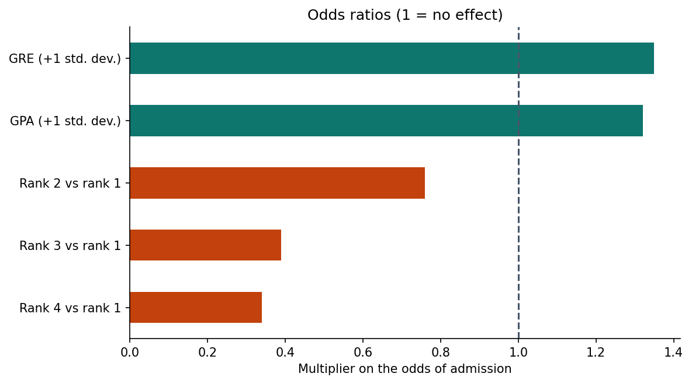
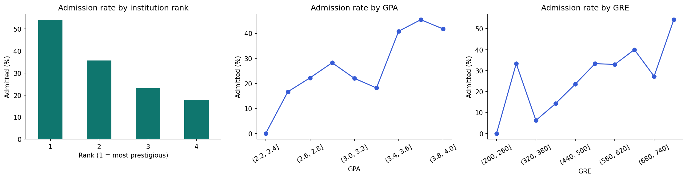
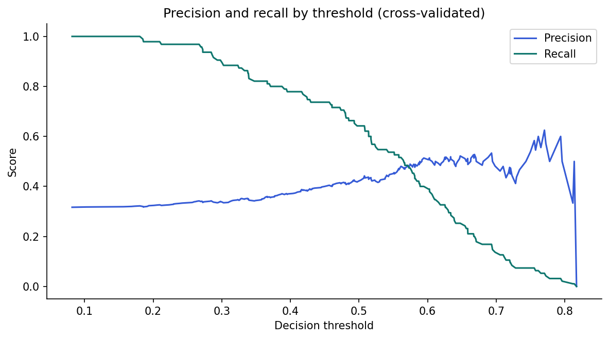

# Student Admission Prediction

A transparent logistic-regression analysis of graduate admissions (400 applicants): which factors matter, by how much (odds ratios), and how well admission can be predicted, with an honest look at accuracy, recall, thresholds, and fairness.

**Author:** Oluwatoyin Olawale Akadiri · [Portfolio](https://oluwatoyinakadiri.com) · [LinkedIn](https://www.linkedin.com/in/oluwatoyin-akadiri/)

## Results at a glance

| Finding | Evidence |
|---|---|
| Institution rank has a large effect | Applicants from rank-4 institutions have about **one-third the odds** of admission vs rank 1 (odds ratio 0.34), at the same GRE and GPA |
| GRE and GPA both help | Each +1 standard deviation raises the odds of admission by about **35% (GRE)** and **32% (GPA)** |
| Predictive power is modest | Test **ROC-AUC 0.67**; balanced model recall 0.53 |
| Accuracy is misleading here | Predicting "not admitted" for everyone already scores **68%** |

## Key findings

1. **Interpretability first.** Odds ratios translate the model into statements an admissions office can act on.
2. **Pick metrics that match the goal.** The default model looks accurate but misses most admitted students (recall 0.17); class balancing raises recall to about 0.64 in cross-validation.
3. **Thresholds are a policy choice.** For shortlisting applicants for human review, a lower threshold (0.4) catches 78% of admitted students.
4. **Know the limits.** Three variables cannot capture essays, research, recommendations, or interviews.







## Fairness and limitations

Institution prestige can encode socioeconomic advantage; a model trained on past decisions would reproduce that bias. It should support, never replace, human review, with errors audited across groups. All predictors are known at application time, so there is no outcome leakage. This is a 400-row teaching dataset.

## Methods

Stratified train/test split · `ColumnTransformer` scaling and one-hot encoding · logistic regression with and without class balancing · 5-fold stratified cross-validation · accuracy, precision, recall, F1, ROC-AUC · precision-recall threshold analysis

## How to run

```bash
git clone https://github.com/Tropy007/student-admission-prediction.git
cd student-admission-prediction
pip install -r requirements.txt
jupyter notebook notebooks/student_admission_prediction.ipynb
```

The notebook downloads the public UCLA teaching dataset automatically.
